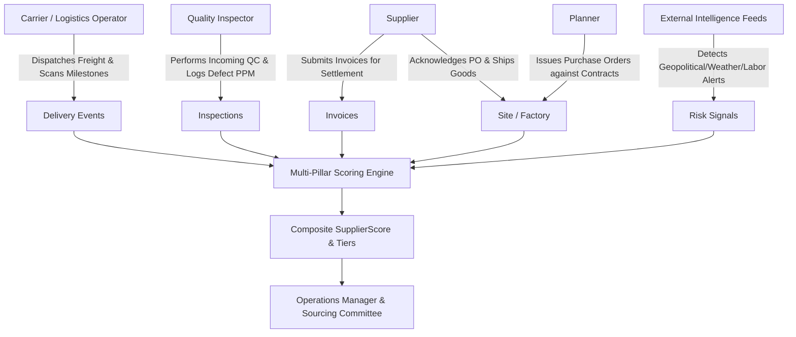

# Architecture & Technical Design: Supplier Reliability Platform

## 1. Problem Statement & Business Context
Global supply chains require quantifiable, objective, and auditable metrics to assess vendor performance and operational resilience. Traditional supplier evaluation suffers from three major flaws:
1. **Siloed Metrics**: Quality inspections, logistics delays, and price creep are evaluated independently without an integrated multi-pillar composite view.
2. **Opaque Scoring**: Scores are often generated by proprietary "black boxes" lacking clear denominators or explainable contribution weights.
3. **Data Leakage & Anomaly Blindness**: Traditional batch systems fail to detect look-ahead bias (using future transactions to evaluate historical performance), temporal desynchronizations (deliveries recorded before carrier dispatch), and tenant conflation (allocating orders to sites owned by other suppliers).

The **Supplier Reliability Platform** solves this by establishing an end-to-end relational data model, deterministic data synthesis with archetype distributions, mathematically rigorous multi-pillar scoring with explicit denominators, and an automated audit validation engine benchmarked against an isolated ground truth registry.

---

## 2. Primary Actors & Operating Workflows



### Supported Roles
1. **Supplier**: Interacts with the platform to review performance scorecards, benchmark subscores against portfolio peers, and resolve dispute tickets.
2. **Planner / Procurement Officer**: Allocates POs to contracted sites, verifies site capacity utilization to avoid bottlenecks, and monitors SLA compliance.
3. **Carrier & Warehouse Operator**: Records discrete timestamped transit milestones (Pickup, Departure, In-Transit Scan, Dock Receipt) and reports transit delays or exceptions.
4. **Logistics & Quality Analyst**: Conducts incoming quality control inspections on received lots, calculates Defect Parts Per Million (PPM), and determines lot dispositions (Accepted, Accepted-On-Deviation, Rejected, Quarantined).
5. **Operations Manager & Sourcing Executive**: Analyzes portfolio tier distribution, conducts what-if policy simulations, audits system anomalies, and makes allocation decisions (e.g. Preferred Partner vs Exit).

---

## 3. Relational Schema & Entity Cardinality

The platform models 11 core entities connected via explicit primary and foreign keys:

```
[Supplier] (1) <---> (N) [Site]
    | (1)
    +--------> (N) [Contract]
    | (1)
    +--------> (N) [PurchaseOrder] (1) <---> (N) [POLine]
    | (1)             | (1)
    |                 +--------> (N) [Shipment] (1) <---> (N) [DeliveryEvent]
    |                 | (1)             | (1)
    |                 |                 +--------> (N) [Inspection]
    |                 +--------> (N) [Invoice]
    | (1)
    +--------> (N) [RiskSignal]
    | (1)
    +--------> (N) [SupplierScore]
```

---

## 4. Multi-Signal Scoring Engine Formulation

Every scoring pillar has an **explicit mathematical formula**, a **clearly defined denominator**, and **explicit missing data handling**.

### Pillar 1: Delivery Reliability ($W_{\text{delivery}} = 0.25$)
- **Denominator**: Total delivered shipments during the evaluation window ($N_{\text{deliv}}$).
- **Metric**: Combined On-Time Delivery Rate (70%) and Fill Rate (30%):
  $$\text{OTD Rate} = \frac{\sum_{i=1}^{N_{\text{deliv}}} \mathbb{I}(\text{status}_i = \text{ON\_TIME})}{N_{\text{deliv}}}$$
  $$\text{Fill Rate} = \min\left(1.0, \frac{\text{Delivered Units}}{\text{Ordered Units}}\right)$$
  $$S_{\text{delivery}} = 100 \times \left(0.70 \times \text{OTD Rate} + 0.30 \times \text{Fill Rate}\right)$$
- **Missing Data Handling**: If $N_{\text{deliv}} = 0$, defaults to neutral baseline $75.0$ and sets `insufficient_delivery_data = True` in explainability telemetry.

### Pillar 2: Quality Performance ($W_{\text{quality}} = 0.25$)
- **Denominator**: Total sample units inspected across QC batches ($U_{\text{inspected}}$).
- **Metric**: Pass Rate penalized by Defect Parts Per Million (PPM):
  $$\text{Accept Rate} = \frac{U_{\text{passed}}}{U_{\text{inspected}}}$$
  $$\text{Defect PPM} = \frac{U_{\text{defective}}}{U_{\text{inspected}}} \times 1,000,000$$
  $$S_{\text{quality}} = \max\left(0, \min\left(100, 100 \times \text{Accept Rate} - \min\left(40.0, \frac{\text{Defect PPM}}{1000} \times 1.5\right)\right)\right)$$
- **Missing Data Handling**: If $U_{\text{inspected}} = 0$, defaults to neutral baseline $80.0$ and sets `insufficient_quality_data = True`.

### Pillar 3: Cost & Invoicing Accuracy ($W_{\text{cost}} = 0.15$)
- **Denominator**: Total PO contracted spend ($\text{Spend}_{\text{expected}}$).
- **Metric**: Relative billing variance and dispute ratio:
  $$\text{Variance Ratio} = \frac{|\text{Spend}_{\text{invoiced}} - \text{Spend}_{\text{expected}}|}{\text{Spend}_{\text{expected}}}$$
  $$S_{\text{cost}} = \max\left(0, \min\left(100, 100 - (\text{Variance Ratio} \times 150 + \text{Dispute Ratio} \times 25)\right)\right)$$
- **Missing Data Handling**: If no invoices exist, defaults to $85.0$ with flag.

### Pillar 4: Capacity Stability ($W_{\text{capacity}} = 0.15$)
- **Denominator**: Total monthly nameplate capacity across active facilities ($C_{\text{total}}$).
- **Metric**: Facility utilization ratio $U = C_{\text{utilized}} / C_{\text{total}}$.
  - Ideal operating band: $55\% \le U \le 85\% \implies S_{\text{capacity}} = 98.0$.
  - Overloaded ($U > 85\%$): Bottleneck risk penalty applied up to 45 pts.
  - Subscale ($U < 55\%$): Viability risk penalty applied up to 35 pts.

### Pillar 5: Compliance & Governance ($W_{\text{compliance}} = 0.10$)
- Base 100 points.
- Deductions: $-30 \times (\text{Uncertified Sites} / \text{Total Sites})$ for missing ISO 9001/14001, $-35$ if no active contract exists.

### Pillar 6: Disruption & External Risk ($W_{\text{disruption}} = 0.10$)
- Telemetry deduction based on severity of active signals:
  $$\text{Penalty} = \min\left(100, \sum_{r \in \text{Active Risks}} \text{SeverityWeight}(r) \times \text{Confidence}(r)\right)$$
  $$S_{\text{disruption}} = \max(0, 100 - \text{Penalty})$$
  *(Critical: 30 pts, High: 16 pts, Medium: 6 pts, Low: 2 pts)*.

### Composite Score & Tier Allocation
$$S_{\text{composite}} = \sum_{k \in \{\text{del, qual, cost, cap, comp, dis}\}} W_k \times S_k \quad (\text{Bounded } [0.0, 100.0])$$

| Tier | Score Range | Decision Recommendation | Operational Strategy |
| :--- | :--- | :--- | :--- |
| **Tier-A** | $90.00 - 100.00$ | **Preferred Partner** | Strategic long-term contracts; automated PO release |
| **Tier-B** | $80.00 - 89.99$ | **Maintain Allocation** | Standard procurement allocations; quarterly reviews |
| **Tier-C** | $70.00 - 79.99$ | **Active Monitoring** | Bi-weekly performance checkpoints; corrective action plan |
| **Tier-D** | $60.00 - 69.99$ | **Conditional Review** | Freeze on new SKU awards; senior executive audit |
| **Tier-F** | $< 60.00$ | **Disqualify / Exit** | Order diversion to alternate suppliers; contract termination |

---

## 5. Labeled Edge Cases & Ground Truth Non-Leakage

To strictly prevent data leakage, the operational tables (`shipments`, `delivery_events`, `supplier_scores`, `risk_signals`, `purchase_orders`) do **not** contain any anomaly label or classification column.

Deliberate edge cases are recorded exclusively in an isolated `ground_truth.json` / `ground_truth.csv` file:

1. **Orphan Shipment (`ORPHAN_SHIPMENT`)**: Physical shipment dispatched without an associated Purchase Order (`po_id = NULL`).
2. **Temporal Inversion (`DELIVERY_BEFORE_DISPATCH`)**: Delivery dock-receipt event recorded prior to carrier dispatch timestamp.
3. **Future Data Leakage (`TIMESTAMP_LEAKAGE`)**: Supplier score calculated at historical timestamp $T_{\text{eval}}$ incorporates future events dated $T > T_{\text{eval}}$.
4. **Missing Provenance (`NULL_PROVENANCE`)**: External disruption signal lacking intelligence source and detection timestamp.
5. **Conflated Sites (`SITE_TENANCY_MISMATCH`)**: Purchase order assigned to a manufacturing site belonging to a foreign supplier.

---

## 6. Audit & Validation Engine

The `AuditEngine` executes 7 formal verification rules:
1. `PrimaryKeyUniqueness`: Absolute uniqueness across all 11 tables.
2. `ForeignKeyIntegrity`: Full relational referential integrity.
3. `AllowedEnums`: Strict validation of all category, tier, and status enums.
4. `DateOrdering`: Logical time ordering across the procurement lifecycle.
5. `ArithmeticReconciliation`: Exact match of line items, order totals, defect PPM formulas, and score subscore sums.
6. `SiteTenancy`: Ensuring sites referenced in POs belong to the contracted supplier.
7. `AuditProvenance`: Ensuring all risk telemetry has accredited sources and timestamps.

The audit findings are dynamically benchmarked against `ground_truth.json` to calculate **Precision**, **Recall**, and **F1-Score**.
